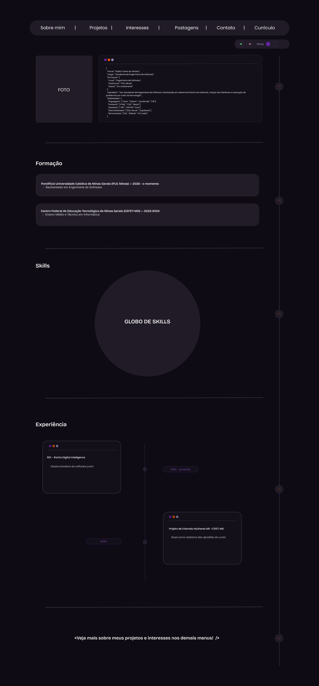
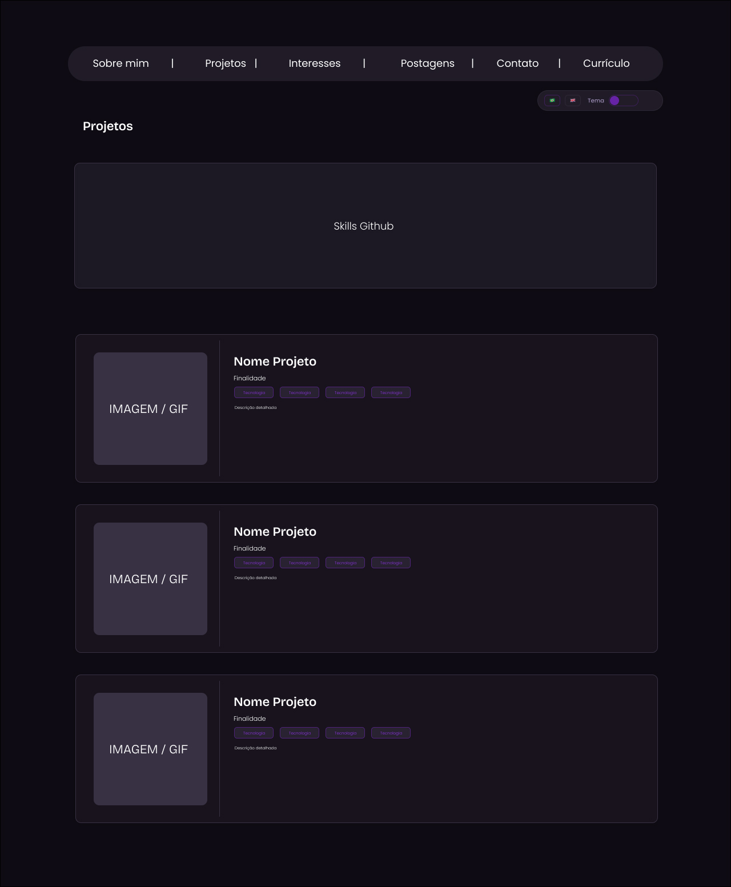
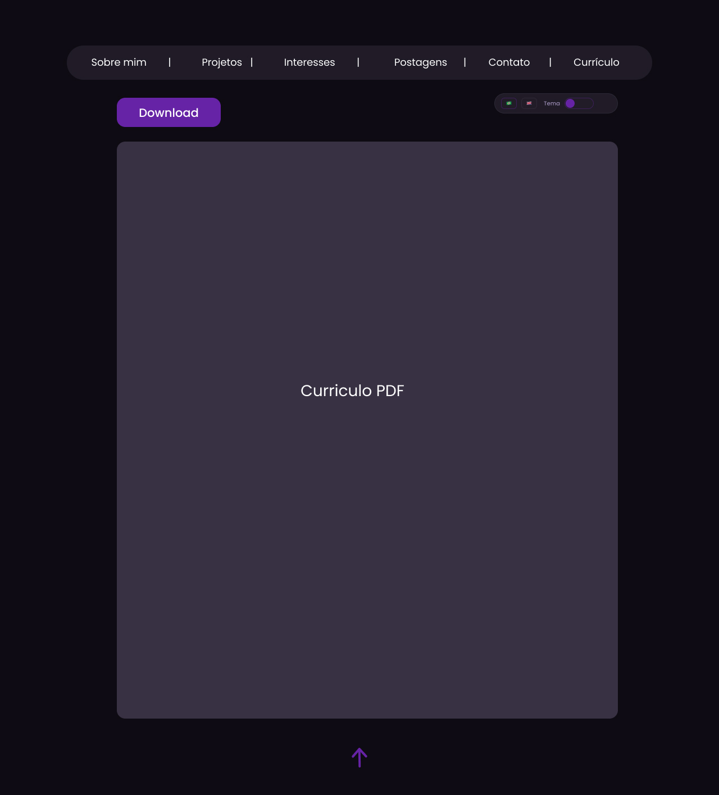
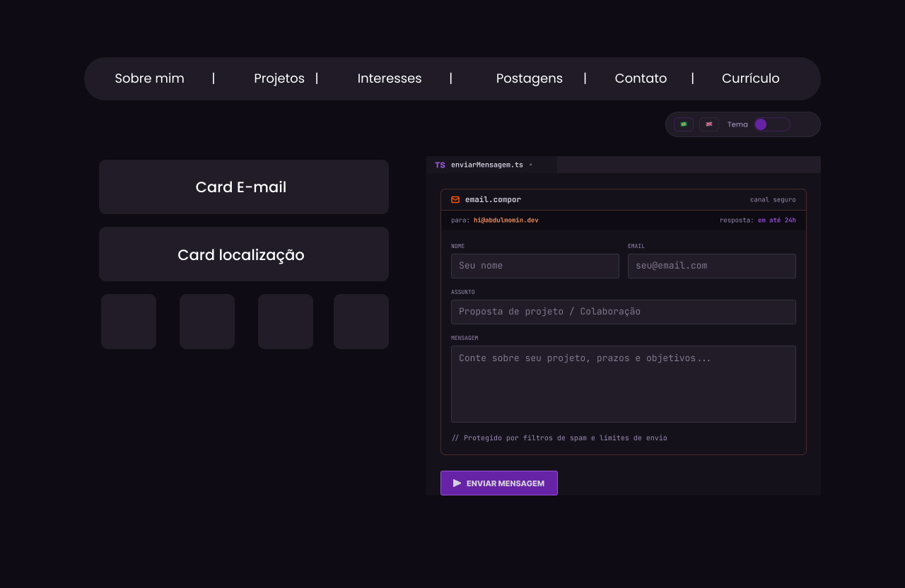

# Portfólio — Núbia Torres

Portfólio pessoal desenvolvido para apresentar minha trajetória acadêmica, experiências, habilidades e projetos de desenvolvimento de software.

## Funcionalidades

- Alternância entre tema claro e escuro e entre português e inglês.
- Perfil profissional, formação, experiências e habilidades.
- Projetos Sintoniza e Star Storm, com prévia visual, vídeo e links.
- Página dedicada para visualização e download do currículo em PDF.
- Formulário de contato integrado ao EmailJS.

## Tecnologias

- React 19
- TypeScript
- Vite
- CSS
- EmailJS

## Como executar

Pré-requisitos: Node.js 18 ou superior e npm.

```bash
git clone https://github.com/nubyoli/portifolio-nubia.git
cd portifolio-nubia/portifolio
npm install
npm run dev
```

Abra o endereço exibido pelo Vite, normalmente `http://localhost:5173`.

## Wireframes

| Sobre mim | Projetos |
| :---: | :---: |
|  |  |

| Currículo | Contato |
| :---: | :---: |
|  |  |

## Autora

**Núbia Torres de Oliveira**  
[GitHub](https://github.com/nubyoli) · [LinkedIn](https://www.linkedin.com/in/nubiaoliveiras)
